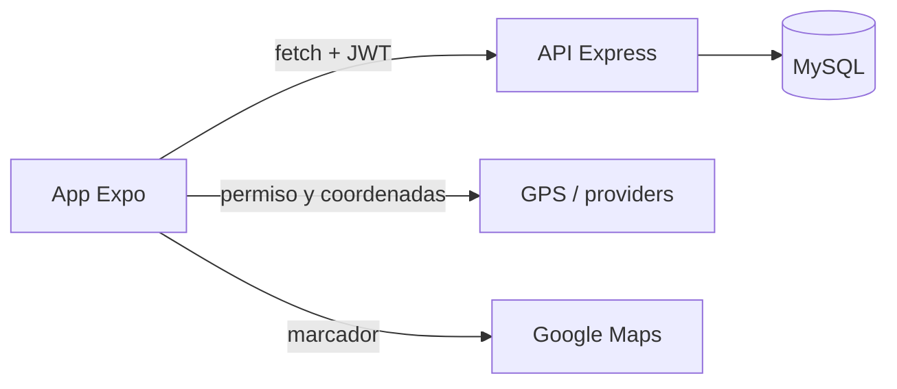
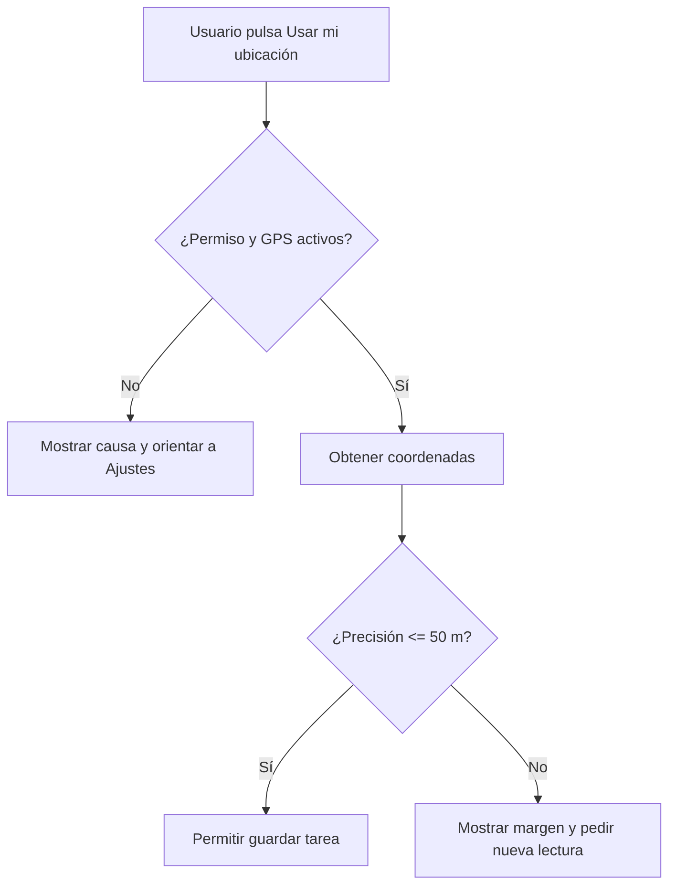

# SIGMA: tareas con MySQL, GPS y mapas

Ejemplo didáctico para la clase 10. La app móvil obtiene una posición real mediante `expo-location`, muestra mapas con `react-native-maps` y guarda la incidencia por medio de una API Express en **MySQL**. No se usa SQLite ni almacenamiento local offline.

## Qué incluye

- Inicio de sesión JWT con los roles `SUPERVISOR` y `TECHNICIAN`.
- CRUD de tareas en la API y base MySQL.
- Captura de GPS al crear o editar una tarea.
- Validación de precisión: se bloquea el guardado si es superior a **50 m**.
- Elección manual de un punto tocando el mapa.
- Marcador en el detalle y mapa general de incidencias abiertas.
- Permiso de ubicación solo cuando el usuario lo solicita.

## Arquitectura



La app nunca accede directamente a MySQL. Las coordenadas viajan como JSON hacia la API, que valida y persiste los datos.

## 1. Crear la base MySQL

Opción rápida con Docker:

```bash
docker compose up -d
```

El archivo `database/schema.sql` se ejecuta la primera vez que se crea el volumen. Para usar una instalación de MySQL propia, ejecutar ese SQL manualmente y configurar `backend/.env`.

## 2. Ejecutar la API

```bash
cd backend
cp .env.example .env
npm install
npm run seed
npm run dev
```

Usuarios de prueba creados por `seed`:

| Rol | Email | Contraseña |
|---|---|---|
| Supervisor | `supervisor@sigma.local` | `sigma123` |
| Técnico | `tecnico@sigma.local` | `sigma123` |

## 3. Ejecutar la app

```bash
cd frontend
cp .env.example .env
# Modificar EXPO_PUBLIC_API_URL con la IP LAN de tu computadora.
npm install
npx expo start
```

Ejemplo: si la computadora tiene IP `192.168.1.25`, usar `http://192.168.1.25:4000/api`. En un celular físico, `localhost` apunta al teléfono, no a la computadora.

## Google Maps y permisos

1. Crear un proyecto en Google Cloud y habilitar **Maps SDK for Android** y/o **Maps SDK for iOS**.
2. Crear una clave por plataforma y restringirla al package Android o bundle iOS de la app.
3. Copiar las claves a `frontend/.env`.
4. Después de cambiar claves o `app.config.js`, crear un development build; Expo Go no incorpora cambios nativos de configuración.

La app solicita `ACCESS_FINE_LOCATION` a través de `expo-location`. Si el usuario deniega el permiso permanentemente, el ejemplo informa que debe habilitarlo desde Ajustes. Para una mejora posterior se puede sumar un botón que ejecute `Linking.openSettings()`.

## Flujo de precisión



La precisión (`accuracy`) representa el radio estimado de error en metros; no significa que el punto sea exacto. Interior, poca batería, clima y red pueden degradarla.

## Endpoints principales

| Método | Endpoint | Uso |
|---|---|---|
| POST | `/api/auth/login` | Obtiene JWT |
| GET / POST | `/api/tasks` | Lista o crea tareas |
| GET / PUT / DELETE | `/api/tasks/:id` | Consulta, edita o elimina |
| POST | `/api/tasks/:id/take` | Técnico toma una tarea libre |
| POST | `/api/tasks/:id/release` | Libera una tarea |
| GET | `/api/tasks/map` | Tareas con coordenadas para marcadores |

> Para producción: no usar las contraseñas de prueba, no dejar el `JWT_SECRET` por defecto, aplicar HTTPS, restringir CORS y proteger las claves de Google Maps.
